# Northfold

[](https://github.com/marcsolans/northfold/actions/workflows/ci.yml)

**Minimal, well-made clothing for men, women and children.** Northfold is a production-grade
fashion store built with Next.js 16, React 19 and TypeScript. It covers the whole commerce loop:
a fast, filterable catalog, a persisted bag that never trusts the browser, checkout with Stripe or
cash on delivery, an idempotent Stripe webhook, a customer account and an admin dashboard. The
server owns every price, stock level and permission check, and every one of those rules is
covered by a test.

> **Live demo:** _add your Vercel URL here after deploying — see [docs/DEPLOY.md](docs/DEPLOY.md)._

| Storefront                         | Product                                       | Checkout                                                    |
| ---------------------------------- | --------------------------------------------- | ----------------------------------------------------------- |
| 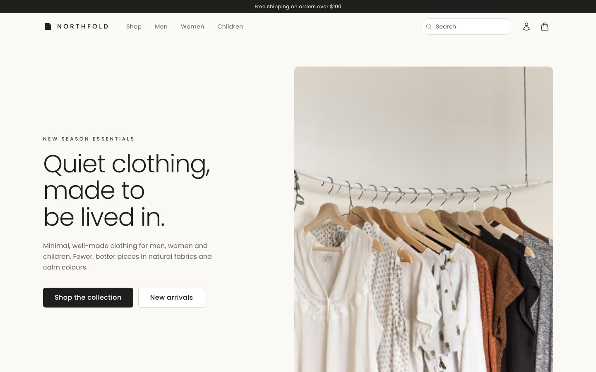 | 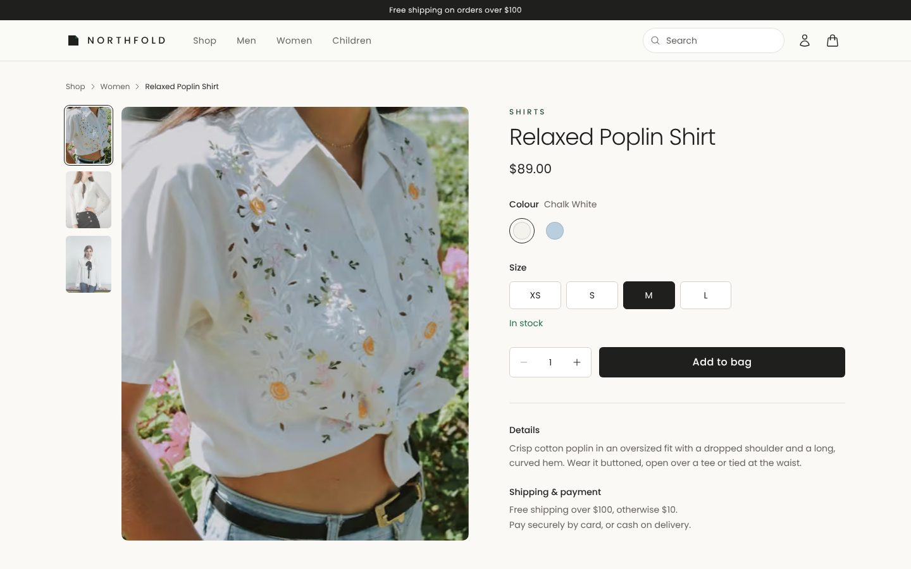 | 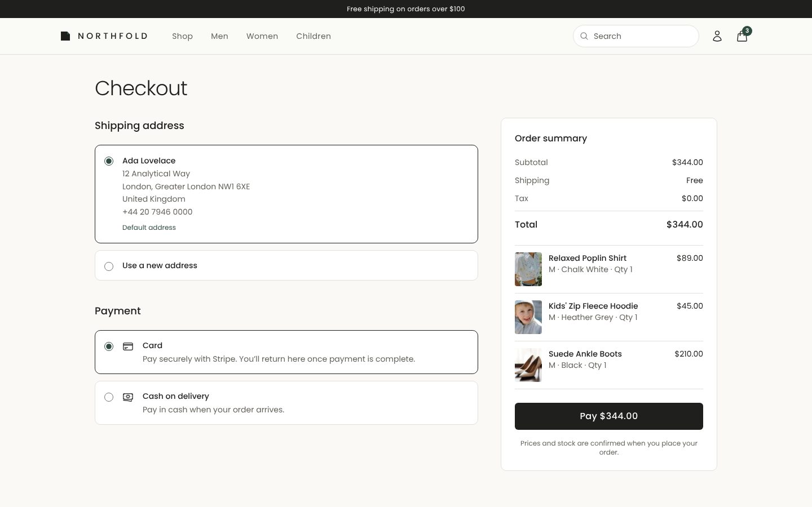                  |
| 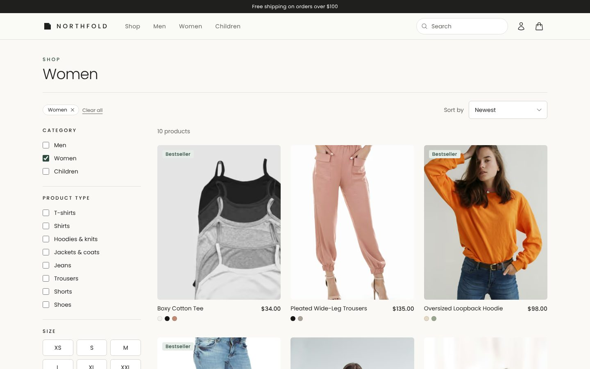 | 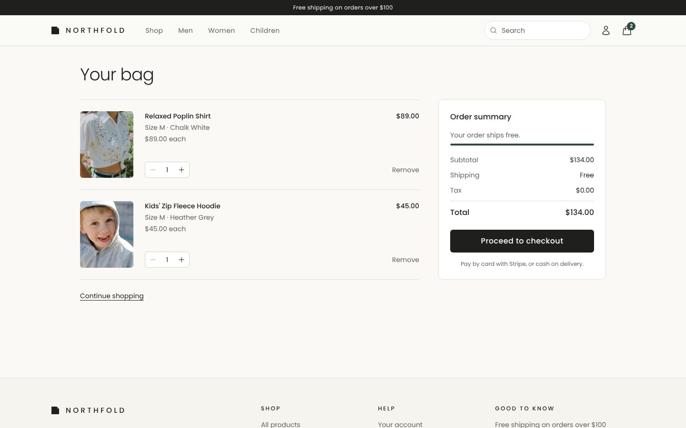             | 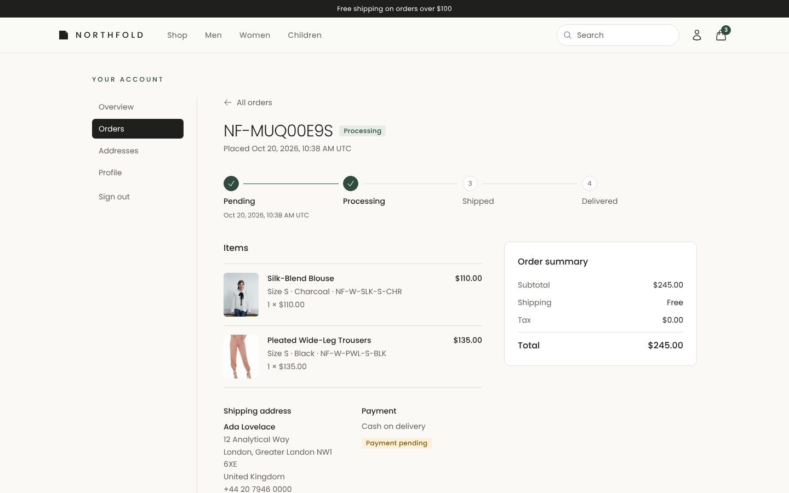 |

| Admin overview                                         | Admin orders                                       | Product editor                                        |
| ------------------------------------------------------ | -------------------------------------------------- | ----------------------------------------------------- |
| 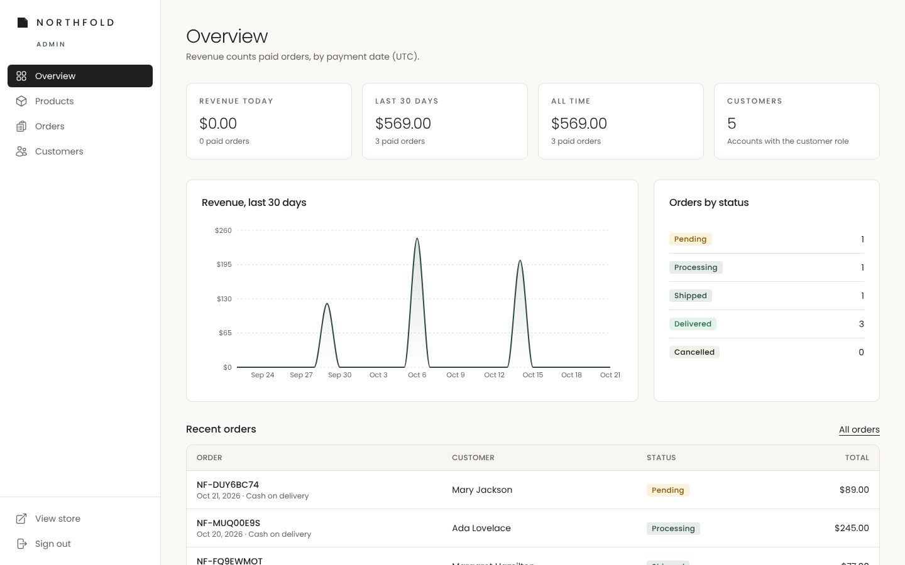 | 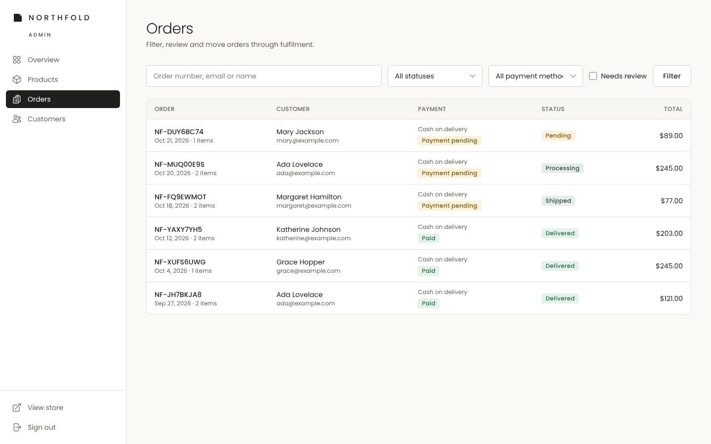 | 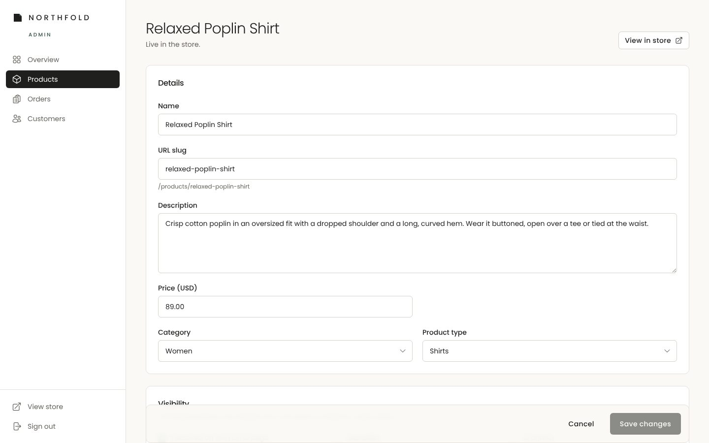 |

| Mobile home                                                                    | Mobile product                                                                       | Mobile filters                                                                       |
| ------------------------------------------------------------------------------ | ------------------------------------------------------------------------------------ | ------------------------------------------------------------------------------------ |
| 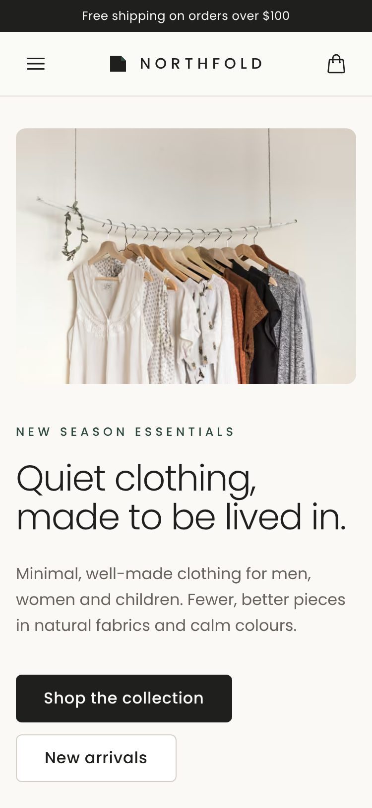 | 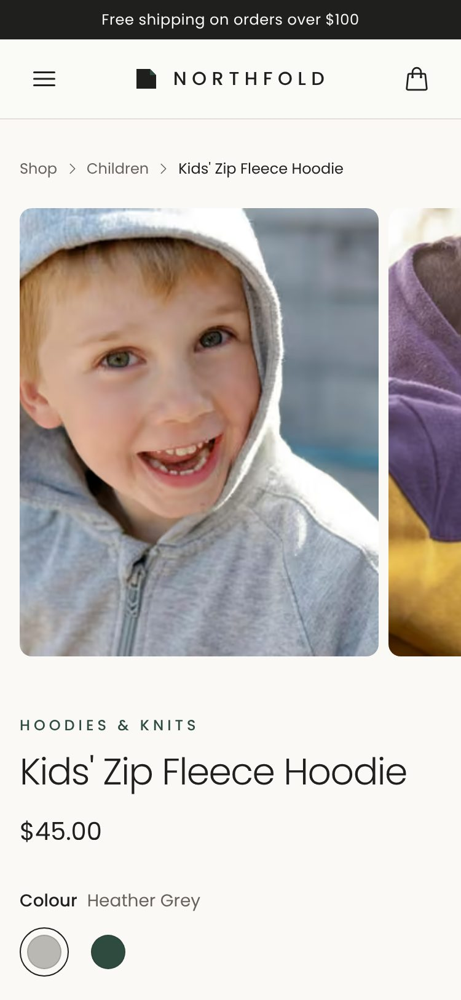 | 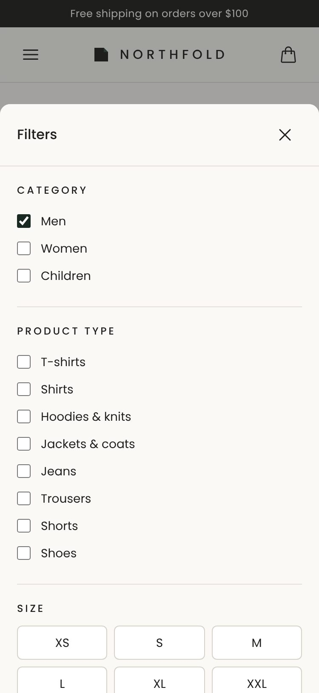 |

## Features

**Storefront**

- Home with hero, categories, featured products and bestsellers.
- Shop page whose state lives entirely in the URL: category, type, size, price range, stock,
  sort, search and pagination. URLs are shareable and the back button works.
- Product pages with a gallery, colour and size selection, live stock state, JSON-LD and Open
  Graph metadata, plus related products. A sitemap and robots.txt are generated.
- Persisted bag (Zustand). It is re-validated against the database whenever it is shown, and
  explains any price, stock or availability change.

**Checkout and payments**

- One checkout for both payment methods: **Stripe Checkout** (cards, 3-D Secure) or **cash on
  delivery**. Saved addresses or a new one.
- `placeOrder` re-prices every line from the database and checks stock. It snapshots product,
  price and address onto the order, and is rate-limited per user.
- The Stripe webhook verifies signatures and is idempotent: an event is processed exactly once,
  even when Stripe retries it. It also checks the paid amount against the order and handles
  async payments and expired sessions.
- Flat $10 shipping, free from $100. Tax is a single configurable constant (0 %).

**Accounts**

- Email and password sign-up/sign-in, or Google (Better Auth).
- Order history with a status timeline. Customers can cancel a pending cash-on-delivery order,
  which restocks it.
- An address book with a single default address, plus profile and password changes.

**Admin**

- Dashboard: revenue today, last 30 days and all time; a 30-day chart; orders by status; low
  stock; recent orders.
- Products: search, create and edit (images by Cloudinary upload or URL, ordering, variants with
  SKU suggestions), archive, or delete products that were never ordered.
- Orders: filters and search. Status changes go through a state machine that handles stock,
  refunds paid card orders on cancellation, and lets an admin resolve orders flagged for review.
- A customers list with order counts and total spent.

**Quality**

- `requireAdmin()` runs inside every admin action and query. One test calls **every exported
  admin action**, as a guest and as a customer, and expects a refusal.
- WCAG 2.1 AA checked with axe on every page at 375 px and 1440 px, in CI.
- Security headers on every response: CSP, HSTS, nosniff, frame denial, referrer and
  permissions policies.
- Lighthouse on a local production build:

  | Page    | Desktop               | Mobile performance |
  | ------- | --------------------- | ------------------ |
  | Home    | 100 / 100 / 100 / 100 | 95                 |
  | Product | 100 / 100 / 100 / 100 | 93                 |
  | Shop    | 100 / 100 / 100 / 92  | 86–89              |

  Desktop scores are performance / accessibility / best practices / SEO. Accessibility and best
  practices are 100 on mobile too. See the notes under _Known limitations_ for the shop page.

## Tech stack

| Area         | Choice                                                                                                            |
| ------------ | ----------------------------------------------------------------------------------------------------------------- |
| Framework    | Next.js 16.4 (App Router, Server Components, Server Actions, Cache Components / Partial Prerendering), React 19.3 |
| Language     | TypeScript 6 (`strict`, `noUncheckedIndexedAccess`)                                                               |
| Styling      | Tailwind CSS 4 (design tokens in `@theme`), Poppins via `next/font`                                               |
| Database     | PostgreSQL 16 / Neon, Prisma 7 with driver adapters (`@prisma/adapter-neon` in production, `pg` locally)          |
| Auth         | Better Auth 1.7 (email/password + Google, Prisma adapter)                                                         |
| Payments     | Stripe Checkout + webhooks (`stripe` 23)                                                                          |
| Images       | Cloudinary signed uploads, `next/image` (AVIF/WebP)                                                               |
| Forms        | React Hook Form + Zod 4 (the same schemas validate on the server)                                                 |
| Client state | Zustand 5 (`persist`, bag only)                                                                                   |
| Money        | `decimal.js`; `Decimal(10,2)` in the database, integer cents only at the Stripe boundary                          |
| Testing      | Vitest 5 (unit + integration on real PostgreSQL), Playwright 1.64 + axe-core                                      |
| Tooling      | ESLint 10 (type-aware), Prettier, Husky + lint-staged, GitHub Actions                                             |
| Hosting      | Vercel + Neon                                                                                                     |

## Architecture

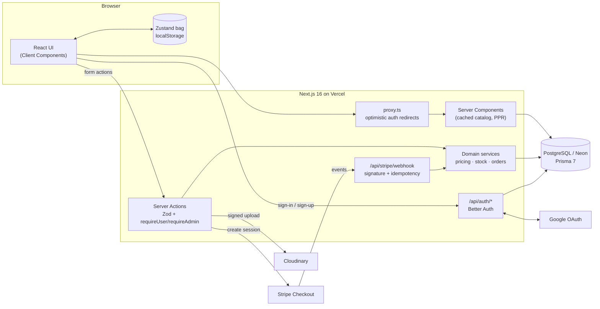

A card payment from the bag to a paid order:

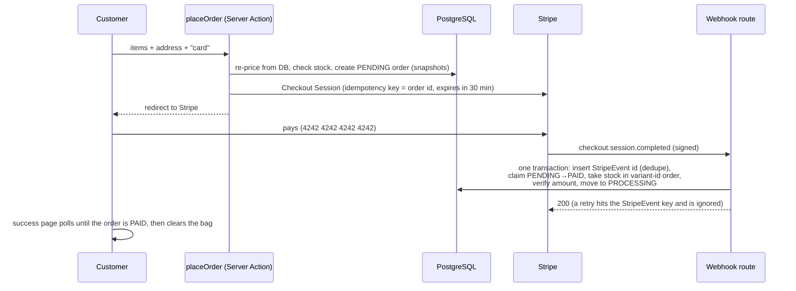

Code layout:

```
src/
├── app/                 routes: (store), (auth), account, admin, api; error/not-found boundaries
├── components/          ui · layout · store · account · auth · admin
├── server/
│   ├── actions/         Server Actions (each returns ActionResult; admin ones call requireAdmin)
│   ├── queries/         reads for Server Components ("use cache" for the catalog)
│   ├── orders/          placing orders, Stripe sessions, stock, admin status changes
│   ├── stripe/          webhook event processing
│   └── auth/            Better Auth config + session guards
├── lib/                 money, pricing, order state machine, validators (Zod), SDK clients
├── stores/              Zustand bag
├── env.ts               validated environment (fails fast with a clear message)
└── proxy.ts             cookie-only redirects for /account, /checkout, /admin
prisma/                  schema, migrations (with CHECK constraints), idempotent seed
e2e/                     Playwright specs (desktop + mobile) and helpers
tests/                   Vitest setup, factories, auth and Stripe helpers
```

## Key engineering decisions

Each decision is one line in [docs/DECISIONS.md](docs/DECISIONS.md). The most important:

- **The server is the source of truth for money and stock.** The browser's bag is only a list of
  variant ids and quantities. Prices are re-read from the database when the bag is shown and
  again when the order is placed. An E2E test tampers with the stored price and checks that the
  order is still charged the real one.
- **Money never touches floats.** Prices are `Decimal(10,2)` in PostgreSQL and `decimal.js` in
  code, and become integer cents only when talking to Stripe.
- **Stock can't go negative.** A `CHECK (stock >= 0)` constraint sits under a conditional
  `UPDATE … WHERE stock >= quantity`, run in variant-id order so concurrent checkouts can't
  deadlock.
  - Cash-on-delivery orders take stock when placed.
  - Card orders take it only when Stripe confirms payment, so abandoned checkouts never hold
    inventory.
  - A rare oversell is compensated in the same transaction and flagged for an admin.
- **The webhook is exactly-once.** The Stripe event id is inserted in the same transaction as its
  effects. A retry hits the primary key and is skipped, while a failed run rolls back the marker,
  so Stripe can retry it.
- **Orders follow a state machine** (`PENDING → PROCESSING → SHIPPED → DELIVERED`, with
  cancellation where allowed). Every transition is a conditional update, so two admins can't
  apply conflicting changes.
- **Authorization lives next to the data.** `proxy.ts` and layouts only redirect optimistically.
  Every Server Action, query and route handler checks the session (and the role) itself, reading
  it fresh from the database for admins.
- **Cache Components / Partial Prerendering.** Catalog reads are `"use cache"` with tags, and
  product pages are prerendered for every product. Purchases and admin edits invalidate the
  catalog tags, so stock and prices on cached pages stay current.
- **One rate limiter for everything.** An atomic PostgreSQL upsert backs both Better Auth's
  limits and the checkout limit, so it holds across serverless instances.
- **Optional integrations stay optional.** Stripe, Google and Cloudinary are enabled
  per group of env vars, and the store runs fully (with cash on delivery) without them.

## Getting started

Prerequisites: Node.js ≥ 22.12, pnpm 10 (`corepack enable`), and PostgreSQL 16, either local or
a free [Neon](https://neon.tech) database.

```bash
git clone https://github.com/marcsolans/northfold.git && cd northfold
pnpm install
cp .env.example .env     # set DATABASE_URL, DIRECT_URL and BETTER_AUTH_SECRET (openssl rand -base64 32)
pnpm db:deploy           # apply migrations
pnpm db:seed             # 26 products with variants and images (safe to re-run)
pnpm dev                 # http://localhost:3000
```

To get an admin account, sign up in the app, put your email in `ADMIN_EMAILS` in `.env`, then
run `pnpm db:seed --admins-only`. A full `pnpm db:seed` would also work, but it re-syncs the demo
products.

Every variable is documented in [`.env.example`](.env.example) and validated at startup by
`src/env.ts`. The optional groups unlock more features:

| Variables                                                              | Unlocks                                                |
| ---------------------------------------------------------------------- | ------------------------------------------------------ |
| `STRIPE_SECRET_KEY`, `STRIPE_WEBHOOK_SECRET`                           | Card payments (otherwise cash on delivery only)        |
| `GOOGLE_CLIENT_ID`, `GOOGLE_CLIENT_SECRET`                             | "Continue with Google"                                 |
| `CLOUDINARY_CLOUD_NAME`, `CLOUDINARY_API_KEY`, `CLOUDINARY_API_SECRET` | Image uploads in the admin (images by URL always work) |

To receive Stripe webhooks locally, run the Stripe CLI and put the printed `whsec_…` value in
`STRIPE_WEBHOOK_SECRET`:

```bash
stripe listen --api-key "$STRIPE_SECRET_KEY" --forward-to localhost:3000/api/stripe/webhook
```

### Stripe test cards

Use any future expiry date, any CVC and any postal code.

| Card number           | Result                                                    |
| --------------------- | --------------------------------------------------------- |
| `4242 4242 4242 4242` | Payment succeeds                                          |
| `4000 0025 0000 3155` | Requires 3-D Secure authentication, then succeeds         |
| `4000 0000 0000 0002` | Declined (the order stays unpaid and its stock untouched) |

## Testing

```bash
pnpm lint && pnpm typecheck && pnpm test && pnpm build   # the gate every commit passes
pnpm test:unit            # pure logic: money, pricing, state machine, validators, bag store
pnpm test:integration     # Server Actions, queries, webhook and auth against real PostgreSQL
pnpm test:coverage        # coverage of src/lib, src/server, src/stores
pnpm test:e2e             # Playwright: builds the app and runs it against a fresh database
```

Integration and E2E tests use local databases named `northfold_test` and `northfold_e2e` (user
and password `northfold`). Create them once:

```bash
createdb -U northfold northfold_test && createdb -U northfold northfold_e2e
```

Point the suites elsewhere with `TEST_DATABASE_URL` or `E2E_DATABASE_URL`. Integration tests
refuse to wipe any database whose name doesn't end in `_test` or `_e2e`.

Current results:

- **233** unit and integration tests in 29 files.
- **Coverage:** 94.3 % statements, 84.2 % branches, 98.3 % functions, 96.7 % lines (thresholds
  80 / 75 / 80 / 80).
- **46 Playwright tests** on desktop (1440 px) and mobile (375 px):
  - Auth flows, and customers kept out of the admin.
  - Browse → filter → bag → cash-on-delivery checkout → order in the account → cancel.
  - Tampered bag prices ignored.
  - Admin creates a product that appears in the shop and then archives it.
  - Admin fulfils an order.
  - Mobile menu and filter sheet.
  - Every page checked for horizontal overflow and axe violations.

CI ([`.github/workflows/ci.yml`](.github/workflows/ci.yml)) runs two jobs, both with a
PostgreSQL 16 service:

1. Lint, format check, typecheck, tests with coverage, migrations, seed and build.
2. The Playwright suite.

## Known limitations

- **No email verification or password reset by email yet**: no email provider is configured.
- **An unknown product URL answers 200 with `noindex`**, not 404. The product is resolved inside a
  streamed Suspense boundary under Partial Prerendering, after the status line is sent.
- **The shop's mobile Lighthouse performance is 86–89** (simulated slow 4G; observed LCP is about
  0.6 s). Its grid depends on search params, so it streams after the static shell, and its
  metadata streams too. Next.js documents that crawlers running JavaScript, such as Googlebot,
  read streamed metadata.
- **Admin stock edits set absolute values**, so two admins editing one product at once means the
  last save wins. Checkout itself is always safe.
- **Cloudinary uploads abandoned before saving** are deleted when removed in the form. Uploads left
  in a tab that is simply closed can stay orphaned.

## Deployment

The store targets Vercel and Neon. [docs/DEPLOY.md](docs/DEPLOY.md) is the step-by-step
checklist: environment variables per environment, migrations on build, Stripe webhook, Google
OAuth, Cloudinary and creating the first admin.
