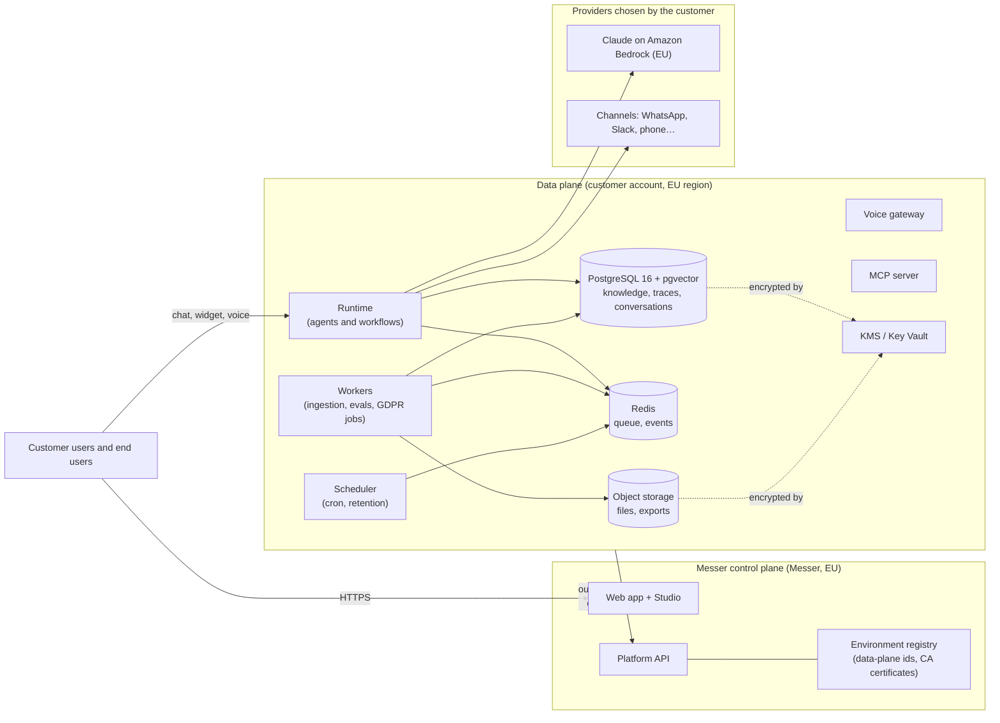

# Customer-cloud deployment (BYOC)

Messer can run its **data plane** in the customer's own cloud account (AWS, Azure or Google Cloud, always in an EU
region) while the **control plane** stays at Messer. The customer's data never leaves their account: Messer only
sends orchestration instructions and receives operational metadata.

## Architecture

* **Control plane** (Messer): accounts, organizations, billing, the Studio UI, project definitions (versioned
  code), deployment orchestration and the environment registry.
* **Data plane** (customer): the `messer-data-plane` Helm chart (runtime, workers, scheduler, voice, MCP) and its
  data services created by the Terraform modules — PostgreSQL 16 with pgvector, Redis, object storage, KMS.

## What crosses the boundary

The data plane opens **one outbound connection** to the control plane (`controlPlane.url`, port 443) authenticated
with **mutual TLS** using a client certificate issued per environment. No inbound port has to be opened towards the
customer's network.

| Direction | Crosses | Never crosses |
|---|---|---|
| Control plane → data plane | Deploy instructions (project version, git commit, environment config), run/stop/resume commands, approval decisions, configuration of triggers and channels | — |
| Data plane → control plane | Health and status, deployment results, run identifiers and states, aggregated usage (tokens, cost, credits) for billing and budgets | Prompts, model outputs, knowledge documents and chunks, table rows, conversation messages, files, trace payloads, secrets |

Traces and conversations are stored in the data-plane database; the Studio reads them **through** the data plane on
behalf of the signed-in user (the runtime authorizes each request against the user's role), so they are displayed
without being copied to Messer. Organizations in **strict EU residency** additionally call Claude only through
Amazon Bedrock in an EU region, use local embeddings and EU-region email/voice providers only (see
`messer_common.residency`).

## mTLS and per-environment certificates

1. `infra/scripts/mtls-gen.sh <env> …` creates a private CA (kept offline by the customer) and, per environment, a
   client certificate (`CN=messer-data-plane:<env>`, `clientAuth`, SPIFFE URI SAN) and a server certificate.
2. The customer registers the **CA certificate** with Messer when the environment is created (the customer-cloud
   environment registration of the deployments module). The control plane accepts a data-plane connection only if its client certificate chains to the CA
   registered for that `dataPlaneId`.
3. The client key, certificate and CA are mounted from the `messer-data-plane-mtls` secret
   (`MESSER_MTLS_CA`, `MESSER_MTLS_CERT`, `MESSER_MTLS_KEY`).
4. Rotation: issue a new certificate with `--force`, update the secret, `kubectl rollout restart`. Revocation:
   remove the CA (or environment) in Messer.

## Installation

1. **Infrastructure** — `infra/terraform/aws`, `infra/terraform/azure` or `infra/terraform/gcp` (see each
   README). Defaults: EU region, private networking, customer-managed keys, encrypted backups.
2. **Secrets** — create `messer-data-plane` (database URLs, Redis URL, `MESSER_SECRETS_KEY`,
   `MESSER_JWT_SECRET`, `MESSER_SERVICE_TOKEN`, model provider keys) and `messer-data-plane-mtls`.
3. **Chart** — `helm upgrade --install messer-dp infra/helm/messer-data-plane -n messer --set
   controlPlane.dataPlaneId=<id>` (see `infra/helm/messer-data-plane/README.md`).
4. **Migrations** — `alembic -c infra/migrations/alembic.ini upgrade head` against the data-plane database (creates
   the `messer_app` and `messer_readonly` roles and row level security).
5. **Verify** — the environment appears as connected in Messer; `kubectl get pods`, `/health` of each service.

## Operations

* **Scaling**: HPAs on runtime, workers and voice; PodDisruptionBudgets on every component; the scheduler uses Redis
  leader election, so extra replicas are hot standbys.
* **Network**: the chart's NetworkPolicy allows ingress only from the release and the ingress namespace, and
  egress to DNS, PostgreSQL, Redis and HTTPS; restrict it further with `networkPolicy.egress.*Cidrs`.
* **Backups and retention**: database backups and object versioning are enabled by Terraform; per-organization
  retention of traces and conversations runs in the scheduler (`tasks/retention.py`).
* **GDPR**: export and deletion jobs run in the data-plane workers, so the export archives and deletion reports are
  produced and stored inside the customer's account.
* **Upgrades**: bump `global.imageTag` (or the chart version), run migrations, `helm upgrade`. Rolling updates keep
  at least one replica of each component available.

On-premise and air-gapped installations use the same chart and images: see [`on-prem.md`](on-prem.md).
